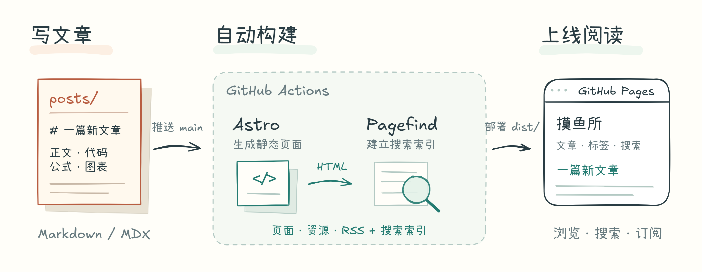

<h1 align="center">小铃殇的摸鱼所</h1>

<p align="center">
  个人技术博客，记录算法学习、Web 开发、AI 工具与日常思考。
</p>

<p align="center">
  <a href="https://github.com/satnaing/astro-paper">
    
  </a>
  <a href="https://github.com/QXiaoLingShang/moyu-suo/actions/workflows/deploy.yml">
    
  </a>
  
  
  
  
</p>

## 关于本站

「小铃殇的摸鱼所」是我持续更新的个人博客。这个仓库保存博客文章和站点实现；文章由我撰写，主要记录算法与 OI、前端和 Astro 实践、AI 相关学习，以及写作和工具使用中的经验。

**在线阅读：**[QXiaoLingShang.github.io/moyu-suo](https://QXiaoLingShang.github.io/moyu-suo/)

## 阅读体验

- 个人主页围绕中心入口组织站点内容；文章、关于和归档可直接进入，项目、相册与友链保留展示位置，待内容上线后开放
- 中英文界面，支持浅色与深色主题
- 按标签与日期浏览文章，也可以全文搜索
- 支持 Markdown、代码高亮、KaTeX 数学公式、Mermaid 图表和提示块
- 文章图片可放大查看；支持 RSS 订阅
- 可设置的[阅读聚焦](src/scripts/reading-focus/README.md)：鼠标跟随强调线或区域高亮、目录跳转标题提示
- 静态生成并部署到 GitHub Pages

## 本地预览

需要 Node.js 22.12 或更新版本，以及 pnpm。

```bash
git clone https://github.com/QXiaoLingShang/moyu-suo.git
cd moyu-suo
pnpm install
pnpm dev
```

开发服务器启动后，打开终端显示的本地地址即可预览。

```bash
pnpm build    # 类型检查、生成静态页面和 Pagefind 搜索索引
pnpm preview  # 本地预览构建结果
```

## 写作与发布

文章以 Markdown 文件保存在 [`posts/`](posts/) 中。新文章可以从 [`posts/_template.md`](posts/_template.md) 开始；目录分类和 front matter 约定见 [`posts/_README.md`](posts/_README.md)。

推送到 `main` 后，GitHub Actions 会构建站点并发布到 GitHub Pages。



## 仓库结构

```text
moyu-suo/
├── posts/                  博客文章、插图和写作模板
├── src/                    页面、组件、样式和站点功能
├── public/                 favicon、默认社交分享图等静态资源
├── docs/readme/            README 架构图及可编辑源文件
├── astro-paper.config.ts   站点标题、作者、语言和功能配置
├── astro.config.ts         Astro、Markdown 处理和部署路径配置
└── .github/workflows/      GitHub Pages 自动部署流程
```

实现入口、功能分工及源码旁的局部说明见 [src/README.md](src/README.md)；全仓规范见 [docs/engineering/](docs/engineering/README.md)。

## 致谢

本站使用 [AstroPaper](https://github.com/satnaing/astro-paper) 作为主题基础。感谢 [Sat Naing](https://github.com/satnaing) 开源这个主题。文章插图使用 [Excalidraw](https://excalidraw.com/) 绘制，并通过[官方 CLI](https://github.com/excalidraw/cli)导出，感谢 Excalidraw 社区。

## License

本项目遵循 MIT License，详见 [LICENSE](LICENSE)。
