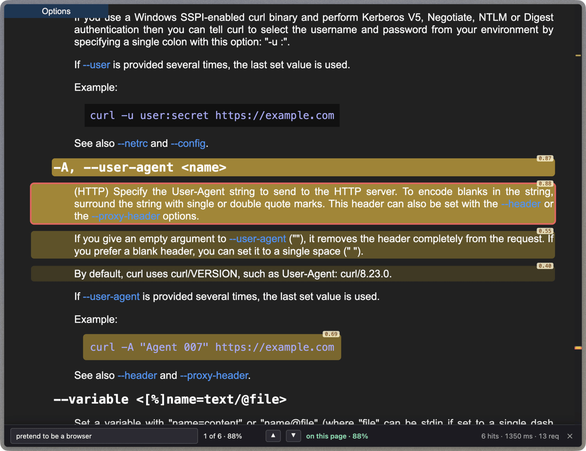
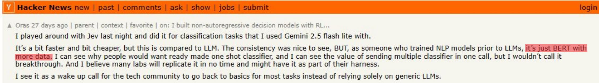
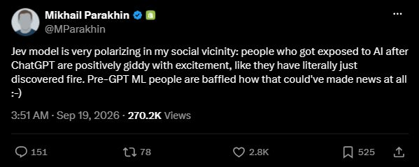
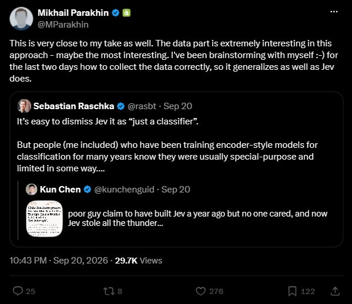

刚看到一篇 [DeskMind 的文章](https://deskmind.dev/zh/blog/launch/)，作者受 Jev 启发，自己训了个小型决策模型想对标 Jev，还做了个跑在 Mac 本地的 Computer Use Agent。

虽然文章有一股 AI 味儿，但倒是提醒了我：我好像还没介绍过上个月大火的 Jev。

Jev 是 TypeSafe 上个月发布的闭源 System One 模型[^system-one]，面向结构化决策。给它一段状态信息和预先定义的问题，它会直接返回选项、评分或概率，并附上置信度。官方称，对于 System One 形态的任务，Jev 在相近智能水平下可比前沿大模型快 40–200 倍（相较于 GPT-6 Astra 和 Fable 5.1）。[^speed-claim]

换句话说，Jev 擅长**极速**做判断——**根据问题，快速把抽象、难以量化的输入，转换成可量化的指标。**

“**可量化**”是一个极其重要的特性。我就这么说吧：**一旦模型返回的是量化的结果，许多以前没法数字化处理的问题，顿时都能交给程序去处理了。**

有了 Jev 以后，公司筛简历、挑面试人将无比容易，再复杂的评估都能被简化成一道打分题。（笑）

## 一个更智能的 Ctrl+F

筛简历这个场景可能有点不切实际，我换个大家每天都在用的：`Ctrl+F`。

想象这么一个场景：你正在看一个超大的文档网站，明确知道里面有某个功能（因为以前用过，或者在哪听说过），但记不得文档里描述它的“准确措辞”。

这时候用传统的 `Ctrl+F` 就很尴尬：词太宽，搜出来上万个匹配结果；词稍微具体一点，又可能因为带不带冠词、换了个形容词之类的细枝末节而什么都搜不到。

那直接把网页丢给现在的 LLM 或 Agent 呢？面对几百 KB 的长文档，它们往往不会直接通读全文，而是先凭经验猜几个关键词，再调工具去网页里搜索、定位、分段读取。来回折腾几轮，不仅慢，多轮调用攒下来的上下文还会消耗不少 tokens。

这时候 Jev 就派上用场了。你不用复述文档里的原话，只要说清楚自己想找什么，系统就能把文档切片后并发交给 Jev，直接按语义判断哪些段落最相关，高亮对应位置并给出置信度分数。

换句话说，搜索不再只是问“有没有出现这个词”，而是可以问“**哪一段讲的是这件事**”。

如图，curl 的官方文档（约 465 KB）转成 PDF 大概有 120 页。我知道 curl 有个功能可以让请求看起来像是浏览器发出的，但忘了具体叫什么参数。

既然不知道关键词，我就直接搜了 `"pretend to be a browser"`。借助 Jev，只用了 1.35 秒就锁定到了 `-A, --user-agent <name>` 的位置，并给出了 0.88 的相关度分数。

**这就是我说的“更智能的 Ctrl+F”：省下来的不是机器扫描文字的时间，而是人反复猜关键词、搜一遍、再翻结果的时间。**

按官方 API 每百万输入 tokens $0.042（输出免费）的价格算，这一下大概花了 2–3 分钱人民币。

1 秒出头，2–3 分钱，就从 120 页的文档里找到了关键位置。

## 普通大模型也能找，差在哪？

普通大模型当然也能找到。我把 curl 官方 man page 的链接和同一个问题交给了几个主流模型，要求它们以这份文档为依据来核实。

先看在 DeepSeek Harness 里跑 DeepSeek V4 Flash 的结果：

它最后找到了 `-A, --user-agent`，还顺带列出了 `--header`、`--referer`、`--compressed`、`--cookie` 等相关选项并解释了作用。这一趟下来花了 49 秒，消耗约 0.2M tokens，算上缓存和空闲时段优惠，大约是 5.1 分钱。[^deepseek-cost]

再看这几个模型具体的执行过程，会发现它们其实都没有直接“通读”文档，而是先靠先验知识猜关键词，再用工具去检索：

- **DeepSeek Harness（49 秒）**：先把 465 KB 的网页下载到本地，用 `grep` 搜了 `pretend|impersonat|mimic` 等词，结果全是 0 命中；接着**根据模型自身的知识猜这个功能**叫 `user-agent`，再去 `grep` 定位行号、分段读取周围的 HTML。[^dsh-trace]

  

- **DeepSeek 官方 Chat**：先尝试全网搜索，发现没法直接确认官方 man page 原文后，才打开该网页并调用 `Find` 工具去搜 `user-agent`、`browser` 和 `pretend`。但因为页面过长，它只定位到了前部的索引行，想往下搜具体描述时直接返回了 `No related content found`，最后又退回搜索引擎翻出了 curl 2008 年的邮件列表补丁，才把答案拼出来。

  

- **ChatGPT（19 秒）**：虽然隐藏了中间步骤，但从搜索记录能直接看出来——它在搜索文档链接后，第二步直接去搜了 `'--user-agent <name>'`。也就是说，它同样是**先知道答案，再去文档里定向查找确认。**

  

可以看出，**普通大模型（或 Agent）处理这类长文档查找时，走的还是“凭已有知识猜关键词 → 调工具搜索定位 → 分段读取”的路子。** 这还是建立在**模型本来就熟悉 curl 参数的前提下**；如果换成一份它**没见过的内部文档**，猜不出关键词，就只能把**整篇文档切片后一段段硬读了**。到时候的花费和时间开销，恐怕得翻好几番吧。

相比之下，Jev 则是把切好的文档段落并发传过去，直接按语义给原文打分——只用了1.35s，不到3分钱的花费，就能直接标出对应位置和给出置信度分数，也不需要生成一大段解释文字。差距可想而知。

## 还能用在哪？

当然，Jev 不只是用来帮人查文档。前面说了，这玩意儿能把“难以量化的输入，快速转换为可量化的指标”，因此**它更适合放进软件流程里，负责那些需要快速判断、而结果又能被程序直接使用的步骤。**

比如：

1. **Agent 评测**：[LangSmith 已经把 Jev 接入了评测器](https://www.langchain.com/blog/jev-is-now-available-in-langsmith-evals)，用它来评估 AI Agent 的运行记录——比如这次回答有没有解决问题、执行过程是否符合要求。评测结果可以作为结构化反馈，供开发者跟踪和改进 Agent。
2. **代码语义搜索**：开源项目 [sgrep](https://github.com/Lagnajit09/sgrep) 把 Jev 用在了代码搜索上。你可以用自然语言问“哪段代码负责用户认证”，它会把代码拆成片段，逐段判断与问题的相关程度，再把可能相关的文件和代码位置排出来。
3. **RAG 检索重排**：开源项目 [jev-reranker](https://github.com/hotchpotch/jev-reranker) 把 Jev 接进了 RAG 流程。先由关键词或向量搜索找出一批候选文档，再让 Jev 判断哪些内容真正相关，把更有用的片段交给后续 LLM。

虽然这些工作普通大模型都能做，但普通大模型有个致命缺点：**慢，太 TM 慢了**（而且还不便宜）。

而 Jev 从设计上就是一个决策特化模型。它不需要把判断过程写成一大段文字，而是直接回答：这段内容和问题有多相关、属于哪一类、应该打几分，或者该选哪个选项。

**这些判断原本很难用程序写死，但 Jev 可以把它们快速转成分数、类别、概率或选项，再交给代码处理。**

至于缺点，目前看主要有三点：

1. **上下文有点小**：默认每次请求最多 64K tokens、每个问题最多 32K tokens；开启 long context 后最高也才 262K，难以直接对一个项目打分评价好坏，是否满足某某需求等等。[^context]
2. **官方有限速**：对普通用户来说，每秒最多只能并发 80 个请求，且输入限流 100,000 tokens/s。[^rate-limit]
3. **判断依据不透明**：普通 LLM 至少还能生成一段自我解释（至于是否忠实反映了真实判断过程，另说）；Jev 直接返回结构化结果。你知道它给了多少分，却不知道这个分数具体是怎么来的、依据是什么。

## 这不就是分类器吗？

不过，写到这里，做过 NLP 的人可能已经觉得眼熟了：文本进去，类别概率出来——这不就是分类器吗？

确实。比如当年常用的 BERT，接个分类头微调一下，就能做成一个基于 Transformer 的分类模型。输入文本，直接算出类别概率，不需要逐字生成解释。[^bert]

如图，输入一句“这手机用了两天就坏了”，交给针对情感分类微调过的 BERT，就能得到好评、中评、差评各自的概率。程序拿着结果，就可以继续筛选、排序或者触发后续操作。

所以，**“把难以写死规则的判断变成程序能处理的分数”，这件事早就有人在做了。**

但这类分类器有个实际问题：**任务变了，通常就得重新适配。** 针对情感分析训出来的模型，想改成判断售后诉求，一般还得准备对应的标注数据、重新微调，没法改几个标签名字就指望它理解新任务。

而 Jev 可以在调用时直接接收问题、判断标准和选项。同一段文本，这次问情绪，下次就能换成判断诉求，不需要为当前任务重新训练——也就是 zero-shot（零样本）能力。

那，新意就在这里吗？

**零样本分类，也早就有了。**

比如基于 NLI（自然语言推断）的分类方法，可以把“这手机用了两天就坏了”和“这是一条负面评价”一起交给模型，判断前一句是否支持后一句。换成“用户想要退货”，就相当于换了一个待判断的说法，不需要为新标签重新训练。2020 年 Hugging Face 就已经提供了这样的零样本分类 pipeline。[^zero-shot]

再近一点，Jev 发布前就有开源的 [GLiClass](https://github.com/Knowledgator/GLiClass)：标签可以临时传入，还能在一次前向计算里处理多个标签。动态标签、直接打分、跳过长文本生成，这些思路都有前例。[^gliclass]

看到这里，也就不难理解为什么有人对 Jev 的走红感到困惑。

HN 用户 Oras 说，他拿 Jev 试了原本交给 Gemini 的分类任务，觉得更快、更便宜，一致性也不错；但作为以前训练过 NLP 模型的人，他的评价是：

> it's just BERT with more data.

他认可现成分类服务的价值，却不认为这是一次突破。[^oras]

不过，**“这些功能早就有了”和“Jev 内部就是 BERT 加数据”，仍然是两回事。** 前者有现成的方法和项目可以对照，后者目前还缺少公开的实现证据。

那，前面测出来的速度和价格优势怎么算？

当然算。1.35 秒找到位置，和等 Agent 搜索、读取、折腾几十秒，对使用者来说差别很实际。

**但别忘了，前文对比的是 Jev 的语义打分流程，和通用大模型调用工具查找文档的流程。** 这说明 Jev 在这次任务里确实更快、更便宜，却不能直接证明它相比已有分类技术进步了多少。

要回答后一个问题，就得把已有的分类器也摆上来，同时比一比判断质量、延迟和成本。拿一个任务固定、文本很短的 BERT 分类器跑出毫秒级结果，不能直接宣布 Jev 多余；反过来，拿 Jev 比生成式大模型快几十倍，也不能宣布分类技术因此发生了革命。

Mikhail Parakhin 前后发过两条评论。他先调侃：ChatGPT 之后才接触 AI 的人像发现了火，早年的 ML 从业者却困惑这为什么能成为新闻；两天后他又补充说，这里面的数据部分可能最关键，自己也在琢磨，怎样收集数据才能获得类似 Jev 的泛化能力。[^parakhin]

**功能形态有前例，不意味着做到同样的效果很容易。** 至于 Jev 的具体提升来自数据、训练方法、模型结构还是服务工程，目前公开的资料还没细说。

说到底，Jev 的走红也提醒了一件事：**在大家习惯了什么都交给生成式大模型之后，分类器这套老东西，又重新回到了视野里。**

它确实好用，前面的几个场景也确实值得尝试。但既然功能早有前例、具体实现又尚未公开，现在就宣布一个全新技术方向，多少有点着急。

至于最后会不会长出一串 Open-Jev、Mini-Jev、Awesome-Jev……那就是另一个故事了。

---

[^system-one]: TypeSafe 说，这个名字受 Daniel Kahneman《思考，快与慢》启发，取自快速、直觉式的 System 1 与缓慢、审慎式的 System 2 这组区分。TypeSafe 将 Jev 定位为前一种快速决策模型，同时认为它可以通过训练做到可靠。见[官方介绍 FAQ](https://typesafe.ai/blog/introducing-system-one-models-and-jev)。

[^speed-claim]: 官方给出的速度范围是 40–200 倍，限定在 System One 形态的任务和相近智能水平比较；工作流评测的参照是 GPT-6 Astra 与 Fable 5.1 的平均结果。见[官方介绍](https://typesafe.ai/blog/introducing-system-one-models-and-jev)。

[^deepseek-cost]: 按空闲时段价格计算：0.021145 × ¥1/M + 0.175488 × ¥0.02/M + 0.006605 × ¥4/M ≈ ¥0.051。价格见[DeepSeek 官方价格表](https://api-docs.deepseek.com/zh-cn/quick_start/pricing/)。

[^dsh-trace]: Trace 里还提到 curl FAQ 有“how do I pretend to be a browser?”这一问，但 Agent 区分了 FAQ 和 man page，没有把 FAQ 当作 man page 的命中。

[^context]: 官方文档说明，开启 `long context` 后速度和准确度可能下降。具体上限见[Jev 官方文档](https://docs.typesafe.ai/models)。

[^rate-limit]: 这是组织级额度，同一组织下的 API keys 共用。实际额度以控制台为准；官方说明见[模型文档](https://docs.typesafe.ai/models)。

[^bert]: 见 [BERT 原论文](https://arxiv.org/abs/1810.04805) §3.2、§4.1。图中概率仅为示意。

[^zero-shot]: 见 Hugging Face 社区的[零样本分类 pipeline 发布帖](https://discuss.huggingface.co/t/new-pipeline-for-zero-shot-text-classification/681)及 Joe Davison 的[介绍文章](https://joeddav.github.io/blog/2020/05/29/ZSL.html)。这里利用的是已训练好的 NLI 模型。

[^gliclass]: 见 [GLiClass 论文](https://arxiv.org/abs/2508.07662)及[开源实现](https://github.com/Knowledgator/GLiClass)。功能形态相近，不代表处理长上下文或复杂判断标准的能力相同。

[^oras]: 见 Oras 在 Hacker News 的[原评论](https://news.ycombinator.com/item?id=49765997)。

[^parakhin]: 见 Mikhail Parakhin 的[最初评论](https://x.com/MParakhin/status/2101036299721347073)与[后续推文](https://x.com/MParakhin/status/2101683565520199887)。

## 参考文献

1. DeskMind. [DeskMind Launch Blog](https://deskmind.dev/zh/blog/launch/). 查阅于 2026-10-17.
2. TypeSafe AI. [Introducing System One Models & Jev](https://typesafe.ai/blog/introducing-system-one-models-and-jev). 2026-09-15.
3. TypeSafe AI. [Models](https://docs.typesafe.ai/models). 查阅于 2026-10-17.
4. Oscar Molnar (Tymscar). [Ctrl+F Finds Words. I Wanted It to Find Answers.](https://blog.tymscar.com/posts/hunchsemanticfind/). 2026-09-30.
5. curl. [curl.1 the man page](https://curl.se/docs/manpage.html). 查阅于 2026-10-17.
6. Winston Huynh. [Jev is now available in LangSmith Evals](https://www.langchain.com/blog/jev-is-now-available-in-langsmith-evals). LangChain, 2026-09-21.
7. Lagnajit09. [sgrep](https://github.com/Lagnajit09/sgrep). 查阅于 2026-10-17.
8. hotchpotch. [jev-reranker](https://github.com/hotchpotch/jev-reranker). 查阅于 2026-10-17.
9. DeepSeek. [模型 & 价格](https://api-docs.deepseek.com/zh-cn/quick_start/pricing/). 查阅于 2026-10-17.
10. Jacob Devlin et al. [BERT: Pre-training of Deep Bidirectional Transformers for Language Understanding](https://arxiv.org/abs/1810.04805). NAACL, 2019.
11. Joe Davison. [Zero-Shot Learning in Modern NLP](https://joeddav.github.io/blog/2020/05/29/ZSL.html). 2020-05-29.
12. Ihor Stepanov et al. [GLiClass: Generalist Lightweight Model for Sequence Classification Tasks](https://arxiv.org/abs/2508.07662). arXiv, 2025.
