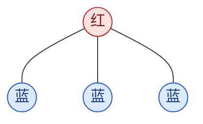
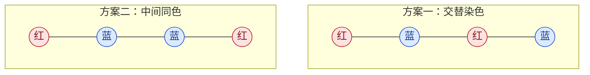

赛时 4 题。

## A 题

> [!note] 题目：[Perfect Sandwiches](https://codeforces.com/contest/2276/problem/A)
> 有 $a$ 片奶酪和 $b$ 片香肠，必须将它们全部用完，且每片恰好放进一个三明治。
> 每个三明治至少有一片奶酪和一片香肠，而且奶酪片数必须严格多于香肠片数。求最多能做多少个三明治，无解输出 $-1$。

解析：

显然贪心。代码先判断 $a\le b$，此时奶酪总数都不比香肠多，一定无解。

否则先将每片香肠与一片奶酪配成一对，还剩 $dif=a-b$ 片奶酪。每个三明治至少放一对，再多放一片奶酪，所以数量最多为 $\min(dif,b)$；剩余的配对或奶酪并入任意一份即可。

```cpp
if (a <= b) {
    cout << -1 << "\n";
} else {
    int dif = a - b;
    int res = min(dif, b);
    cout << res << "\n";
}
```

**送的**

## B 题

> [!note] 题目：[Replace and Compress](https://codeforces.com/contest/2276/problem/B)
> 给定长度为 $n$ 的二进制串 $s$，依次进行两步操作：
>
> - 至多选择一个下标 $2\le i\le n-1$，将 $s_i$ 取反，也可以不修改；首尾字符不能修改。
> - 将每一段连续相同字符压缩为一个字符，例如 `100111011` 变成 `10101`。
>
> 求最终能得到多少种不同的字符串。

解析：

先看压缩后的结果，$0,1$ 一定交替出现，而且首尾不能修改。因此：

> **推论 1：** 起始字符固定后，压缩串由长度唯一确定，只需考虑操作对长度的影响。

翻转 $s_i$ 只影响它与两侧字符的分界，分三种情况：

| 翻转前的三个字符 | 翻转后的三个字符 | 压缩长度的变化 |
| --- | --- | --- |
| `000` / `111` | `010` / `101` | $+2$，多一对 $01$ |
| `010` / `101` | `000` / `111` | $-2$，少一对 $01$ |
| `001` / `011` / `100` / `110` | 分界移动 | 不变 |

所以最多只有三种结果。不操作的结果先计入答案，再看能否增加、减少一对 $01$，各计一次即可。

```cpp
int res = 1;
bool more = false, less = false;
for (int i = 1; i + 1 < n; i++) {
    if (s[i - 1] != s[i + 1]) continue;
    if (s[i] == s[i - 1]) more = true;
    else less = true;
}
res += more + less;
cout << res << "\n";
```

时间复杂度 $O(n)$，空间复杂度 $O(1)$。

## C 题

> [!note] 题目：[Subarrays](https://codeforces.com/contest/2276/problem/C)
> 给定长度为 $n$ 的正整数数组 $a$ 和整数 $1\le k<n$，统计元素和能被 $k$ 整除、且长度严格大于 $k$ 的连续子数组数量。

解析：

先看合法子数组 $[l,r]$ 的特征：长度严格大于 $k$，且元素和能被 $k$ 整除，即：

$$
r-l+1>k,\qquad \sum_{i=l}^{r}a_i\equiv0\pmod k
$$

设 $pre[i]$ 是前 $i$ 个元素之和，$pre[0]=0$。第二个条件可以改写为：

$$
(pre[r]-pre[l-1])\bmod k=0
\iff pre[r]\equiv pre[l-1]\pmod k
$$

再令 $j=l-1$，长度条件就是 $r-j>k$，因此：

> **推论 1：** 固定右端点 $r$，合法子数组的数量，等于 $0\le j\le r-k-1$ 中满足 $pre[j]\bmod k=pre[r]\bmod k$ 的下标数。

于是从左往右枚举 $r$，按余数维护前缀和出现次数。每次右端点右移，恰好有一个新的前缀下标满足距离要求，将它加入计数即可，也就是延迟加入。

```cpp
using ll = long long;
vector<ll> pre(n + 1, 0);
for (int i = 0; i < n; i++) pre[i + 1] = pre[i] + a[i];

vector<int> idx(k, 0);
idx[0]++;
ll res = 0;
for (int i = k; i < n; i++) {
    res += idx[pre[i + 1] % k];
    idx[pre[i + 1 - k] % k]++;
}
cout << res << "\n";
```

注意一定先查询再加入，否则会把长度恰好为 $k$ 的子数组也算进去。

时间复杂度 $O(n)$，空间复杂度 $O(n)$。

## D 题

> [!note] 题目：[Caveman](https://codeforces.com/contest/2276/problem/D)
> 给定一个有 $n$ 个点、$m$ 条边的无向简单图，将每个点染成红色或蓝色，要求每个点至少有一个与自己颜色不同的邻点。
> 求合法染色方案数，但只需区分四种情况：没有方案输出 `Brain Melt`，恰好 $1$ 或 $2$ 种时输出对应数字，多于 $2$ 种时输出 `Many`。只要有一个点的颜色不同，就视为不同方案。

解析：

这题主要是构造特例、注意特判，考验注意力。

有孤立点显然无解；否则每个连通块取一棵生成树，按树的深度交替染色，每个点都能通过树边找到异色邻点，因此一定有解。

> **推论 1：** 无解当且仅当存在孤立点。而有解时，整体交换红蓝就得到另一种不同方案，所以不存在恰好一种方案的情况。

接下来找只有两种方案的特例。星形树如下，所有叶子只与中心相连：
（一个链长为3的图也属于星形树）



叶子必须与中心异色，所以中心颜色确定后，所有叶子也随之确定。图中的染色与整体红蓝互换，恰好两种。

下证其余情况，一定超过2种染色方案：

1. 若不连通，即有 k 个连通块(k>=2)。  
那么每一个连通块都有2种范安，总方案数为 2 * k >= 4种

1. 若联通，由于结点数为3时，属于星形树，考虑过了。  
考虑一条四个点的简单路径，可以如下染色：



两种染色中，每个点都有异色邻点，再加上各自的红蓝互换，已经有四种。剩余点每次沿一条连接到已染色部分的边扩展，染成与父节点相反的颜色，就能补全；其它边也不会破坏已有的异色邻点。

除此之外，还有一种“三角形”的特例，对于这种方案：除了全红、全蓝外都合法，恰好六种。

这样，不连通、含四点路径、三角形三种情况就覆盖了所有剩余图，而且每种都至少有四种方案。

> **推论 2：** 无孤立点时，只有整张图是一棵星形树的答案为 $2$，其余都是 `Many`。

最后总结：

| 图的情况 | 答案 |
| --- | --- |
| 存在孤立点 | `Brain Melt` |
| 整张图是一棵星形树 | $2$ |
| 其余情况 | `Many` |

代码里维护度数。没有孤立点后，$m=n-1$ 且最大度数为 $n-1$ 就是星形树，后面的链、环等分类其实都可以省掉。

```cpp
int maxDeg = 0;
for (int i = 1; i <= n; i++) {
    if (cnts[i] == 0) {
        cout << "Brain Melt\n";
        return;
    }
    maxDeg = max(maxDeg, cnts[i]);
}
cout << (m == n - 1 && maxDeg == n - 1 ? "2\n" : "Many\n");
```

时间复杂度 $O(n+m)$，只存度数时空间复杂度 $O(n)$。

## E 题

> [!note] 题目：[Good Substrings](https://codeforces.com/contest/2276/problem/E)
> 给定长度为 $n$ 的数字串 $s$。若一个子串（substring）[^substring] 包含 `2025` 作为子序列（subsequence）[^subsequence]，但不包含 `2026` 作为子序列，则称它为坏子串；其余都是好子串。
> 对每个下标 $i$，求有多少个好子串包含位置 $i$，即满足 $1\le l\le i\le r\le n$ 且 $s_l\ldots s_r$ 是好子串的 $(l,r)$ 数量。

解析：

赛时一直围绕位置 $i$ 向左右考虑边界，感觉情况太多，没想出来。赛后讨论时换成固定左端点 $l$，条件就一下子全串起来了：

固定[l, r]的`l`时，让右端点 `r` 不断右移，包含 `2025`、包含 `2026` 都是一旦成立就不会消失的条件。记二者最早完成的位置为 $p_5,p_6$，找不到时记为 $n+1$，则：

> **推论 1：** 固定 $l$，坏子串的右端点恰好构成区间 $[p_5,p_6-1]$。若 $p_5\ge p_6$，这个左端点没有坏子串。

接下来求这两个位置。注意题目要求的是子序列，不能用 `substr(i, 4)` 匹配连续串。预处理 `nxt[i][d]`，表示从位置 $i$ 开始，数字 $d$ 第一次出现的位置。

`2025` 和 `2026` 的公共前缀都是 `202`，从 $l$ 开始依次贪心跳到最近的 `2,0,2`，设最后到达 $p$，则 $p_5=\text{nxt}[p+1][5]$，$p_6=\text{nxt}[p+1][6]$。每一步越早匹配，给后续留下的范围就越大，因此这样得到的就是最早完成位置。

现在记坏右端点区间为 $[L,R]$。每个坏子串 $[l,r]$ 会给覆盖的所有位置贡献一次，所以：

> **推论 2：** 固定 $l$，其所有坏子串对位置 $i$ 的贡献，分成常数段和等差段：

| 位置范围 | 坏子串数量 |
| --- | --- |
| $[l,L-1]$ | $R-L+1$ |
| $[L,R]$ | $R-i+1$ |

其余位置贡献为 $0$。前一段中的位置虽然早于首次凑齐 `2025`，但仍被每个坏子串覆盖，不能漏掉。

等差段可以通过差分来实现，不过这里需要维护两个信息，一个截距 db，一个斜率 dk

$$R-i+1=-i+(R+1)$$

分别维护斜率、截距的差分数组 `dk,db`，区间加 $ki+b$ 就转化为两个普通区间加。最后求前缀和，用 $ki+b$ 得到坏子串数量，再从总数 $i(n-i+1)$ 中减去即可。

代码如下，使用 $1$ 下标。未找到数字时统一返回 $n+1$，因此找不到 `2026` 时自然有 $R=n$；若连 `202` 都找不到则直接跳过。

```cpp
using ll = long long;

void solve() {
    int n;
    cin >> n;
    string s;
    cin >> s;
    s = " " + s;

    // nxt[i][d]: 从 i 开始，数字 d 第一次出现的位置。
    vector<array<int, 10>> nxt(n + 2);
    nxt[n + 1].fill(n + 1);
    for (int i = n; i >= 1; i--) {
        nxt[i] = nxt[i + 1];
        nxt[i][s[i] - '0'] = i;
    }

    vector<ll> dk(n + 2, 0), db(n + 2, 0);
    // 对区间 [l, r] 加上 k * i + b。
    auto add = [&](int l, int r, ll k, ll b) {
        if (l > r) return;
        dk[l] += k;
        dk[r + 1] -= k;
        db[l] += b;
        db[r + 1] -= b;
    };

    for (int l = 1; l <= n; l++) {
        int p = l - 1;
        for (int d : {2, 0, 2}) {
            if (p == n + 1) break;
            p = nxt[p + 1][d];
        }
        if (p == n + 1) continue;

        int L = nxt[p + 1][5];
        int R = nxt[p + 1][6] - 1;
        if (L > R) continue;

        // 坏子串 [l, r] 的右端点 r 可以取 [L, R]。
        add(l, L - 1, 0, R - L + 1);
        add(L, R, -1, R + 1);
    }

    ll k = 0, b = 0;
    for (int i = 1; i <= n; i++) {
        k += dk[i];
        b += db[i];
        ll bad = k * i + b;
        ll res = 1LL * i * (n - i + 1) - bad;
        cout << res << " ";
    }
    cout << "\n";
}
```

时间复杂度 $O(n)$，空间复杂度 $O(n)$。

## F 题

> [!note] 题目：[Permutation Coloring Game](https://codeforces.com/contest/2276/problem/F)
> 给定一个由 $1$ 到 $n$ 各出现一次组成的排列 $p$，初始所有元素都是白色。Alice 和 Bob 轮流操作，Alice 先手。
> 每回合选择 $1$ 到 $k$ 个白色元素，将本回合选中的元素全部染成红色或全部染成蓝色。所有元素都被染色后，游戏结束。
> 若能通过任意次交换同色元素，将排列变成升序，则 Alice 获胜，否则 Bob 获胜。交换的两个元素不要求相邻，求双方最优时谁获胜。

解析：

TODO

## G 题

> [!note] 题目：[Elimination of Players](https://codeforces.com/contest/2276/problem/G)
> 有 $n$ 名玩家，编号为 $1$ 到 $n$，强度分别为 $s_1,s_2,\ldots,s_n$，构成 $1$ 到 $n$ 的一个排列。所有玩家初始都在场，共进行 $n-1$ 轮，每轮恰好淘汰一人。
> 第 $j$ 轮保护玩家 $a_j$。若当前强度最小的玩家未被保护，就淘汰他；否则淘汰当前强度第二小的玩家。被淘汰的人不再参与，受保护的玩家也可能早已被淘汰。
> 给定保护序列 $a$，强度排列未知。记 $ans(i,j)$ 为玩家 $i$ 恰好在第 $j$ 轮被淘汰的强度排列数，对 $998244353$ 取模后的值。输出：
>
> $$\bigoplus_{i=1}^{n}\bigoplus_{j=1}^{n-1}\bigl(ans(i,j)\cdot i\cdot j\bigr).$$
>
> 其中 $\oplus$ 为按位异或。只对 $ans(i,j)$ 取模，乘积及最终异或结果不取模。

解析：

TODO

[^substring]: 子串由原字符串中连续的一段字符组成。例如，`025` 是 `2025` 的子串，`205` 则不是。

[^subsequence]: 子序列可以通过删除原字符串中的若干字符得到，不要求连续，但保留字符的相对顺序不变。例如，`2025` 是 `220325` 的子序列。
